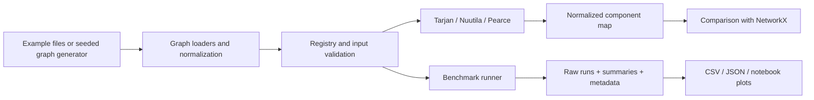

# Strongly Connected Components

**Three graph algorithms, one correctness and benchmarking harness.** Python implementations of Tarjan, Nuutila and Pearce find groups of nodes that can all reach one another in a directed graph.

This project demonstrates algorithm implementation, explicit input contracts, differential testing against NetworkX, and reproducible performance measurement. It began as a 2017/2018 Politecnico di Milano course project and has been extended with reusable loaders, a registry, notebooks and CI.

SCCs are useful when investigating cyclic dependencies, reachability and connected subsystems. This repository explores the underlying algorithms with generated and small example graphs; it does not claim a deployed business application.

## Evidence at a glance

| Engineering question | Inspect the evidence |
| --- | --- |
| Do the implementations agree on the answer? | [Correctness tests](tests/test_scc_algorithms.py): all 512 directed graphs on three nodes, plus boundary cases, known partitions and seeded random graphs, compared with NetworkX. |
| Is the code reusable beyond a notebook? | [Algorithm registry](algorithms/registry.py), [typed results](algorithms/specs.py), [file loaders](graph_io/loaders.py) and [benchmark runner](benchmarks/runner.py). |
| Can results be reproduced and scrutinized? | [Executed benchmark](docs/BENCHMARK_RESULTS.md): 90 timed executions, raw CSV, summaries, seeds and environment metadata. |
| What runs automatically? | [GitHub Actions](https://github.com/GuidoBorrelli/strongly-connected-components/actions): unit tests and CLI checks on Linux, macOS and Windows, plus code-quality checks. |

## Quick start

Requires **Python 3.14**; local development is pinned to 3.14.3 in `.python-version`. Earlier versions are unsupported.

```bash
git clone https://github.com/GuidoBorrelli/strongly-connected-components.git
cd strongly-connected-components
python3.14 -m venv .venv
source .venv/bin/activate
python -m pip install -r requirements.txt
python -m unittest discover -s tests -p 'test_*.py'
python main.py
```

On Windows, create the environment with `py -3.14 -m venv .venv` and activate it with `.venv\Scripts\Activate.ps1` in PowerShell. Alternatively, use the existing Conda setup: `conda create -n scc python=3.14.3 -y`, then `conda activate scc`.

The default CLI runs the correctness harness. It prints a Boolean result for each algorithm and exits non-zero if any partition disagrees with NetworkX. No credentials, external services or dataset downloads are required.

```python
from algorithms.registry import run_algorithm
from graph_io.examples import load_example_graph

graph = load_example_graph("two_sccs")
result = run_algorithm("tarjan", graph)
print(result.component_count)  # 3: two cycles and one singleton
print(result.component_map)    # node -> component representative
```

## Architecture and design choices



- **NetworkX** supplies the graph representation, file readers, generators and independent reference implementation. The three SCC algorithms are implemented in this repository.
- **A common registry and result contract** separate algorithm selection from loading and measurement. Component IDs may differ across implementations, so tests compare partitions rather than raw labels.
- **Seeded graph generation and raw exports** make input graphs repeatable and keep the aggregation inspectable. Timing includes validation and result normalization; it is not an isolated measurement of the DFS function.
- **NumPy, pandas and Matplotlib** support numerical summaries, CSV export and plots. `psutil` supports the optional process-memory experiment.

## Testing and results

```bash
python -m unittest discover -s tests -p 'test_*.py'
python main.py
```

Local validation on 14 November 2026 passed **19 tests** under Python 3.14.3. The exhaustive three-node test checks 512 possible edge sets, including self-loops and isolated nodes, against all three implementations: 1,536 algorithm/reference comparisons within that test. Tests also cover loaders, invalid labels, repeat counts, variance units and collision-safe exports. CI re-runs the suite on pull requests; the Actions page records the current status.

The [small benchmark](docs/BENCHMARK_RESULTS.md) shows how to reproduce the experiment without editing configuration. Its measurements are a worked example, not evidence that one algorithm is universally fastest.

## Explore the implementation

| Path | Purpose |
| --- | --- |
| [`algorithms/`](algorithms/) | SCC implementations, registry and result types |
| [`graph_io/`](graph_io/) | File loading, relabeling and generated graphs |
| [`benchmarks/`](benchmarks/) | Cases, timing, summaries and exports |
| [`tests/`](tests/) | Correctness and platform regression tests |
| [`notebooks/`](notebooks/) | Platform introduction, SCC tutorial and benchmarking |
| [`data/examples/`](data/examples/) | Small inspectable graphs |
| [`config.py`](config.py), [`main.py`](main.py) | CLI configuration and entry point |

The notebooks support kernels started in the repository root or `notebooks/`, using the same Python 3.14 environment. Relative output paths resolve from the kernel working directory. Algorithm background and literature references are in [docs/ALGORITHMS.md](docs/ALGORITHMS.md).

## Full benchmark and memory modes

Runtime switches live in `config.py`:

- **Correctness:** `TEST = True`, `MEMORY_TEST = False`.
- **Full benchmark:** `TEST = False`; `python main.py` exports `runs.csv`, `summary.csv` and `metadata.json` under `results/`, and plots under `graphs/`.
- **Memory experiment:** set `TEST = True`, `MEMORY_TEST = True`, `GRAPH = True` and run once to generate a graph. Then set `GRAPH = False` and select `ALG_TEST` (`1` Pearce, `2` Nuutila, `3` Tarjan). See [memory notes](docs/MEMORY_NOTES.md).

## Limitations and lessons

- Inputs must be directed graphs with integer labels `0` through `n - 1`. File loaders can relabel inputs with `load_graph(..., relabel=True)`.
- Recursive DFS can exceed Python's recursion limit, including on a 1,500-node chain. These implementations are educational; large or adversarial graphs need an iterative implementation and separate validation.
- The original algorithms have linear-time designs, but this Python Nuutila implementation performs list-based stack membership checks. Do not infer a proven linear-time bound or production-scale performance for this implementation from the algorithm name.
- Benchmarks use a fixed algorithm order without warm-up. Machine load and interpreter overhead affect small measurements. Dependency floors are specified rather than a complete lockfile; exported package versions identify the measured environment.
- Memory mode measures the change in process RSS after execution, **not peak algorithm memory**. Existing charts and the 2018 memory notes are historical material, not current performance guarantees.
- Timing variance is in squared units. Older exports made before the variance conversion correction understate milliseconds² by a factor of 1,000 and should be regenerated.

## Provenance and license

The repository identifies Guido Borrelli as author and includes an [MIT license](LICENSE). Algorithm references and attribution are retained in [the technical notes](docs/ALGORITHMS.md); the current benchmark uses generated graphs. The original course presentation remains historical supporting material. See [contribution guidelines](CONTRIBUTING.md) and [citation metadata](CITATION.cff).
